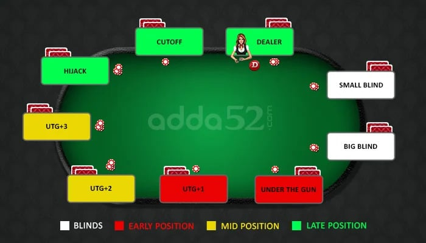
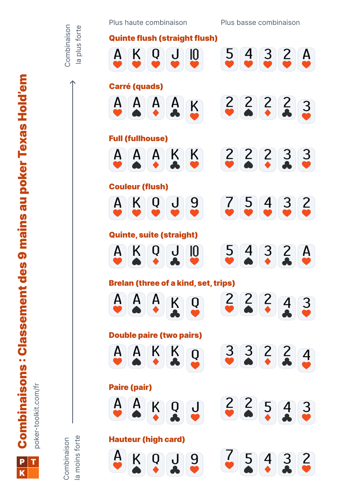
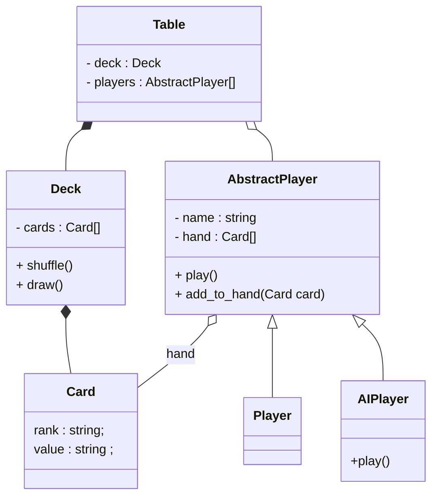

Vous devez réaliser une petite API permettant de simuler des parties de poker.

Votre application ne doit pas implémenter le front end lié.

Votre application doit stocker en base de données, des statistiques pour chaque partie: 
- l'identifiant de l'utilisateur victorieux
- Le temps d'une partie

## Règles du texas Hold'em
Le Poker est un jeu d'argent.

Avant de jouer, achetez en caisse votre cave (somme minimum demandée pour prendre place à la table). ( Nous simulerons 1000 €)

Face à vos adversaires, formez la meilleure combinaison de 5 cartes en choisissant parmi vos 2 cartes personnelles et les 5 cartes communes découvertes sur la table.



Avant la donne, le croupier dispose un jeton "Premier joueur" au 1e joueur à sa gauche. Les 2 joueurs à gauche du donneur placent des mises obligatoires : les blinds. Le 1er pose la **petite blind** et le deuxième place la **grosse blind**. Le montant de ces mises est indiqué à la table.

Le croupier distribue à chaque joueur assis 2 cartes "face cachée".

Une fois les cartes distribuées, le joueur placé à gauche de la **grosse blind** parle en premier, il peut soit :

- **Passer** (fold), il jette alors ses cartes
- **Suivre** (call), il s’aligne sur la plus haute mise
- **Relancer** (raise), il double au minimum la mise la plus haute.

Il n'y a pas de maximum de relance, le joueur peut faire tapis (all-in) : miser tous ses jetons en une seule fois. 
Un tour de mises se finit lorsque tous les joueurs qui ont des cartes ont engagé la même mise. 

Une fois le tour de mises fini, l'ensemble des mises sont rassemblées et mises dans **le pot**.

Le croupier "brûle" une carte. ( Il prends la première carte de la pile et la défausse fasse cachée. )
Le croupier dépose 3 cartes découvertes sur la table. Un nouveau tour d’enchères débute. Le 1er joueur après le donneur parle en premier.

A ce stade, le joueur a une option de jeu supplémentaire : 
- **Checker** Il ne mise pas et attend de voir ce que font ses adversaires. Dès qu’un joueur mise de l’argent, cette option n’est plus possible.

Une fois le tour de mises fini, les mises de cette enchère sont mises dans le pot.
Le croupier "brûle" une carte.
Le croupier dépose une 4ème carte commune sur la table, suivie d’un 3ème tour d’enchère

Une fois le tour de mises fini, le croupier "brûle" une carte puis  dépose une 5ème carte commune sur la table, suivie d’un 4ème tour d’enchère

Le croupier identifie la main gagnante et paye le vainqueur avec le pot.
Avant de démarrer un nouveau jeu, le croupier déplace toujours le bouton au joueur suivant, récupère toutes les cartes, puis mélange les cartes.

A noter que l’as peut être utilisé comme la carte la plus petite devant le 2 ou comme la plus forte, derrière le Roi.



## Objectif
Vous devez implémenter une API fonctionnelle , implémentée via Nest JS, qui n'attends plus qu'un front end afin de pouvoir lancer des parties de Texas Holdem.
Votre code doit : 
- être versionné sur GIT (plateforme de votre choix)
- être accompagné d'un fichier `README.md` avec la description du projet et des fonctionnalités mises en place.
- Le `README.md` doit également contenir une explication d'installation de l'application.
- chaque membre de votre équipe doit avoir commité
- Votre dépôt ne doit contenir aucun fichier superflu.

Plus vous avancez mieux c'est mais privilégiez la qualité à la quantité.

## Méthodo :
 - Au sein de chaque équipe, définissez l'ensemble des routes qu'il vous faut ( Verbe + route + payload)
 - Définissez votre kanban et votre organisation pour travailler via git. 
 
## Obligatoire :
- Liste des routes actives au sein de votre README.
- Un joueur peut se créer un compte, automatiquement une cave de 1000€ lui est allouée.
- Un joueur peut s'inviter à une table. S'il est seul, automatiquement une IA se joint à la table.
- Génération des cartes et distribution aléatoire (2 cartes par joueur)
- Implémentation des règles pour les blindes et pour les mises.
- Dès qu'un utilisateur augmente sa mise, son solde est actualisé (donc décrémenté en toute logique) au sein de la BDD.
- Mise en place d'une authentification via jeton JWT
- Mise en place d'un swagger documentant les routes accessibles ainsi que les erreurs potentielles

Vous n'êtes pas obligés d'implémenter l'ensemble du code du poker mais il est attendu à ce qu'un premier "round" de mises puisse être réalisé.

## Bonus :
- Comparaison des combinaisons
- Respect des règles du texas holdem.
- Couverture du code par le biais de tests unitaires

## Barème provisoire: 
 - /1 Propreté des commits
 - /2 Qualité du README
 - /3 Propreté du code (nommages, absence de code superflu, etc...)
 - /2 Pertinence des routes choisies
 - /2 Qualité du swagger
 - /2 Authentification, pertinence du JWT, Sécurité sur les routes
 - /8 Fonctionnalités implémentées et respect du cahier des charges
 

```bash
node --version
```

